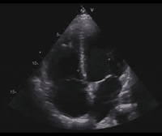
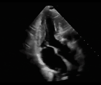
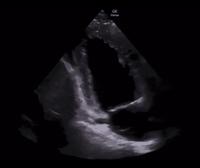
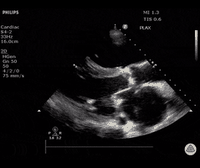
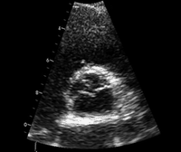
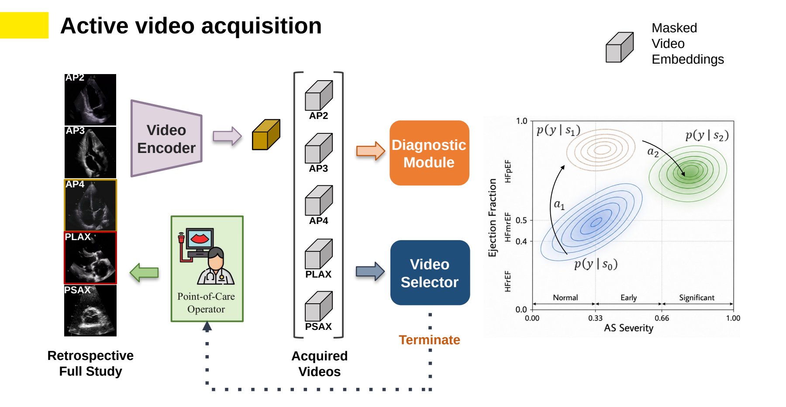
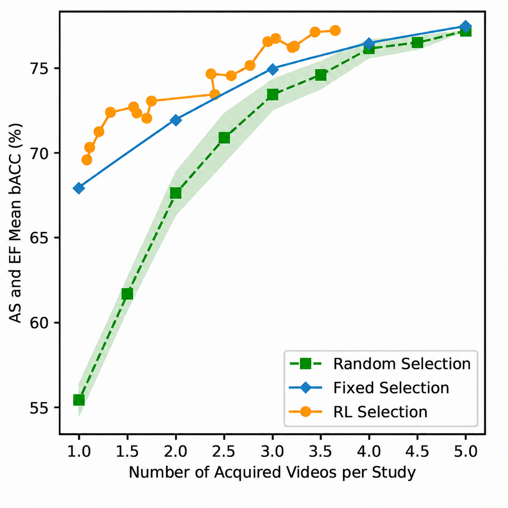
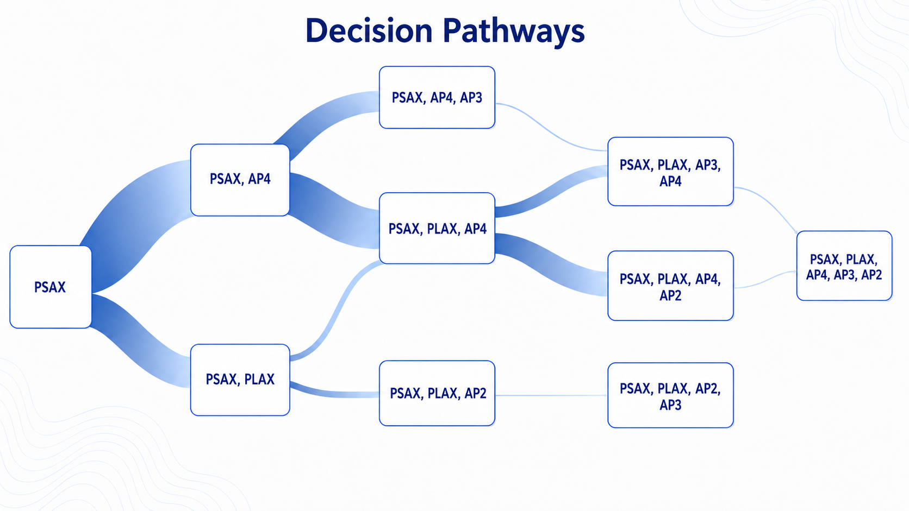

<h1 align="center">Double-Precise</h1>

<p align="center"><strong>Which echo view comes next—and when is it enough?</strong></p>
<p align="center">Learning to acquire fewer ultrasound videos for joint, uncertainty-aware cardiac assessment.</p>

<p align="center">
  <a href="https://arxiv.org/abs/2602.13658"></a>
  <a href="https://link.springer.com/article/10.1007/s11548-026-03680-6"></a>
  
</p>

<p align="center"><a href="#how-it-works">Method</a> · <a href="#results">Results</a> · <a href="#getting-started">Getting started</a> · <a href="#citation">Citation</a></p>

<p align="center">
  
  
  
  
  
  <br><sub>Five candidate views: AP4 · AP3 · AP2 · PLAX · PSAX-Ao. Illustrative clips from the project presentations.</sub>
</p>

| Fewer videos | Joint diagnostic performance | Held-out evaluation |
| :---: | :---: | :---: |
| **32% reduction** | **77.2% mean balanced accuracy** | **1,820 studies** |
| 3.4 videos on average, out of 5 | Across AS severity and LVEF categories | From a cohort of 12,180 studies |

Official PyTorch implementation of **[Optimizing Point-of-Care Ultrasound Video Acquisition for Probabilistic Multi-Task Heart Failure Detection](https://arxiv.org/abs/2602.13658)**, presented at **IPCAI 2026**.

Armin Saadat, Nima Hashemi, Bahar Khodabakhshian, Michael Y. Tsang, Christina Luong, Teresa S. M. Tsang, and Purang Abolmaesumi<br>
University of British Columbia · Vancouver General Hospital

## Why learn what to acquire?

Every additional ultrasound view takes time. The information it adds depends on what has already been seen—and on the patient. Double-Precise learns to select the next view and decide when to stop, balancing diagnostic performance against acquisition cost.

The system jointly estimates **aortic stenosis (AS) severity** and **left ventricular ejection fraction (LVEF)**, including predictive uncertainty. It starts with no observed views and builds a patient-specific acquisition sequence.

## How it works

<p align="center"></p>

1. **Encode the acquired views.** A frozen EchoPrime video encoder extracts features from available clips; unobserved views remain masked.
2. **Update the joint prediction.** A task-aware Transformer fuses the observed views to estimate AS severity and LVEF probabilistically.
3. **Choose a view—or stop.** A PPO policy uses the current state to select the next acquisition or terminate, balancing diagnostic value with the cost of another video.

The loop above illustrates the intended acquisition workflow. Experiments in this repository select from **pre-acquired retrospective studies**.

## Results

At the reported operating point, Double-Precise achieved **77.2% mean balanced accuracy with 3.4 videos per study**, matching full-acquisition performance with **32% fewer videos**. Evaluation used **1,820 held-out studies** from a **12,180-study cohort**.

<p align="center"></p>

<p align="center"><sub>The learned policy improves the performance–acquisition trade-off relative to fixed and random selection. Different acquisition-cost settings produce different operating points.</sub></p>

### Different patients, different pathways

The policy can branch after observing a view, choosing a different next acquisition for different patients. The presentation's simplified pathway diagram shows how the selected view sets develop across a study.

<p align="center"></p>

<details>
<summary><strong>Explore the detailed pathway figure</strong></summary>

Nodes show partial-view states, patient counts, stopping points, and AS/LVEF balanced accuracy for patients diagnosed at each state. Edges show the learned selection transitions.


</details>

## Getting started

### Requirements

- **Python 3.11.13**, as pinned in `pyproject.toml`, and Poetry.
- Prepared study data and diagnostic-model checkpoints. The private clinical dataset and required pretrained checkpoints are not supplied by these setup commands.

```bash
git clone https://github.com/Armin-Saadat/Double-Precise.git
cd Double-Precise
conda create --name double-precise python=3.11.13 pip
conda activate double-precise
python -m pip install poetry
poetry install
```

### Configure your experiment

Edit [`configs/default.yaml`](configs/default.yaml) for your environment:

| Setting | Purpose |
| --- | --- |
| `data.dataset_path` | Location of the prepared dataset |
| `classifier.as_classifier_path` | AS classifier checkpoint |
| `classifier.ef_regressor_path` | LVEF model checkpoint |
| `agent.agent_checkpoint` | Trained acquisition policy for evaluation, or a checkpoint to resume |
| `environment.lammy` | Acquisition-cost weight |
| `device` | Compute device; the default is `cpu` |
| `use_wandb` / `wandb_mode` | Logging controls; disable W&B with `use_wandb: false`, or use `wandb_mode: offline` |

### Train

```bash
poetry run python run.py \
  --config_path ./configs/default.yaml \
  --save_dir ./logs/train-run \
  --train
```

### Evaluate

Set the dataset and checkpoint paths in the configuration before running:

```bash
poetry run python run.py \
  --config_path ./configs/default.yaml \
  --save_dir ./logs/eval-run \
  --evaluate
```

## Data and scope

The echocardiography dataset was collected under institutional review board approval and is not publicly distributed with this repository. Results concern sequential selection from existing multi-view studies. Prospective validation is needed to establish performance during live bedside POCUS acquisition.

Presentation-derived figures and compressed animations are documented in [`docs/assets/README.md`](docs/assets/README.md).

## Citation

If this work supports your research, please cite:

```bibtex
@inproceedings{saadat2026pocusacquisition,
  title     = {Optimizing Point-of-Care Ultrasound Video Acquisition for Probabilistic Multi-Task Heart Failure Detection},
  author    = {Saadat, Armin and Hashemi, Nima and Khodabakhshian, Bahar and Tsang, Michael Y. and Luong, Christina and Tsang, Teresa S. M. and Abolmaesumi, Purang},
  booktitle = {International Conference on Information Processing in Computer-Assisted Interventions (IPCAI)},
  year      = {2026}
}
```
